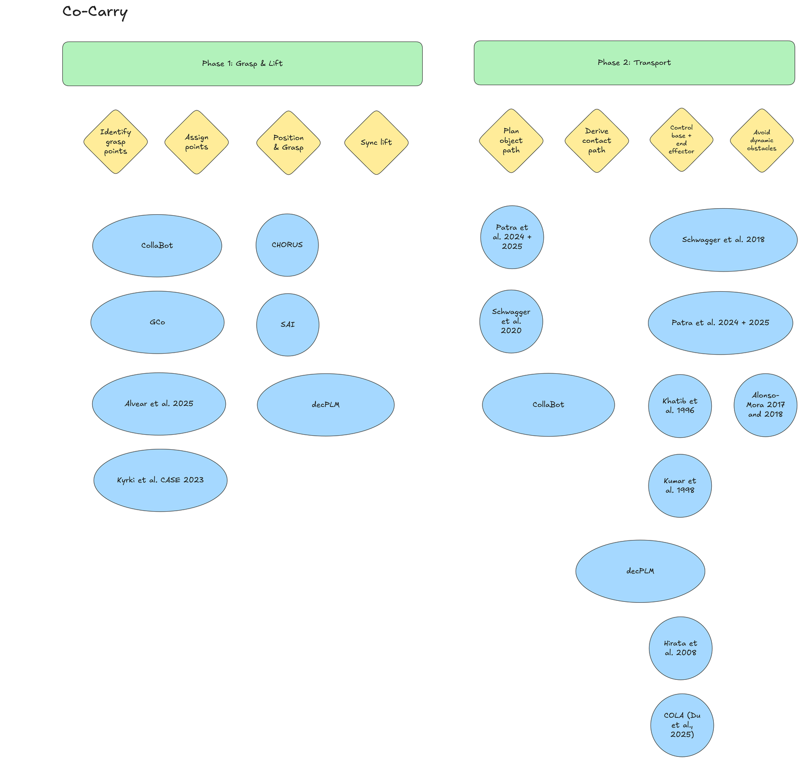

**Author:** Ethan · Oct 14–15

## Overview

After the pivot to co-carry on independent mobile bases, the team collected 15 papers on a shared Co-Carry board. I read through them and mapped each one to the eight steps of the task, with notes on what each paper means for our hardware: two SO-101 arms on LeKiwi bases, 8 months, and no motion capture.

| Phase | Steps |
| :--- | :--- |
| 1. Grasp & Lift | (1) identify grasp points, (2) assign points, (3) position & grasp, (4) sync lift |
| 2. Transport | (5) plan object path, (6) derive contact paths, (7) control base + end effector, (8) avoid dynamic obstacles |

#### Main finding
The biggest gap isn't a step, it's **localization**. Nearly every paper relied on motion capture, a fixed camera, or shared global state to know where the robots are. Only CollaBot, Hirata/Kosuge, and COLA work with onboard sensing alone, which is the constraint we've set for ourselves.

#### Recommended starting points
- **Grasp selection (steps 1–2):** Alvear et al. 2025. It picks grasp pairs that still work for the whole route, so a doorway feeds back into which end each robot grabs.
- **Leader path planner (steps 5, 8):** Patra et al. 2024/25. It handles doorways and moving obstacles, and plans paths in 0.09 s vs 8.4 s for Alonso-Mora's on the same map.
- **Follower controller (steps 6–7):** Hirata/Kosuge caster-like dynamics. Followers comply with the object and don't need to know where the other robots are.
- **Grasp and lift learning (steps 3–4):** SAI's single-operator data collection sequence, plus decPLM's shared sync timer to start the lift together.
- **Baseline:** CHORUS, as the end-to-end comparison rather than the architecture to copy.

## What we did

- Reviewed all 15 papers on the Co-Carry board and wrote up method, results, step coverage, and relevance for each
- Built a coverage matrix of papers vs. the eight steps
- Identified onboard localization as the main gap across the literature
- Proposed board corrections: a new lane for onboard localization (UWB ranging + odometry), moving Culbertson & Schwager out of step 8, and adding MART (Tung et al., ICRA 2021) as a candidate for the synchronized lift

## Next steps

- Research onboard localization options (UWB + odometry fusion) so it doesn't block the transport work
- Bench-test a follower-side stop for obstacles the leader can't see, which no paper covers
- Verify the papers marked as not yet read in full before citing them in the PDP or report
