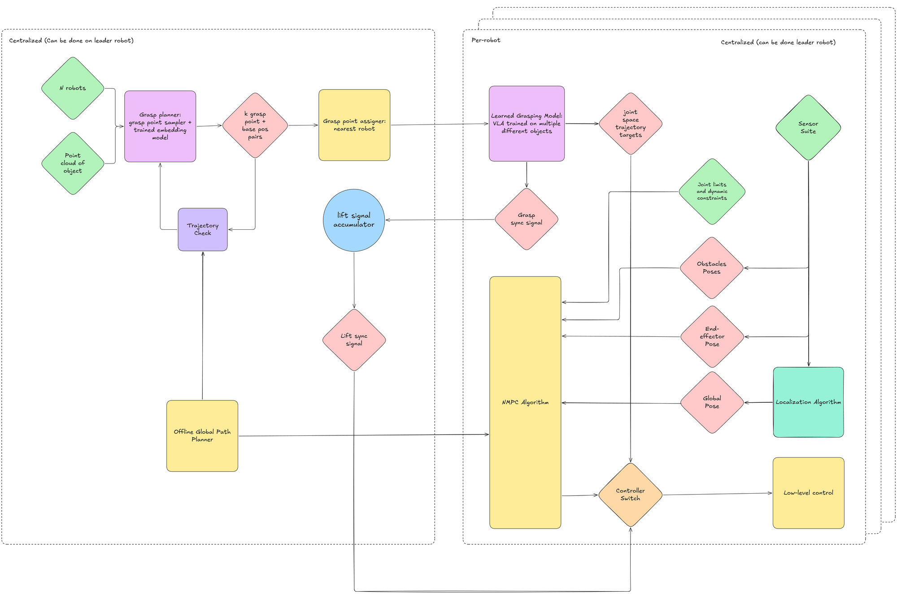
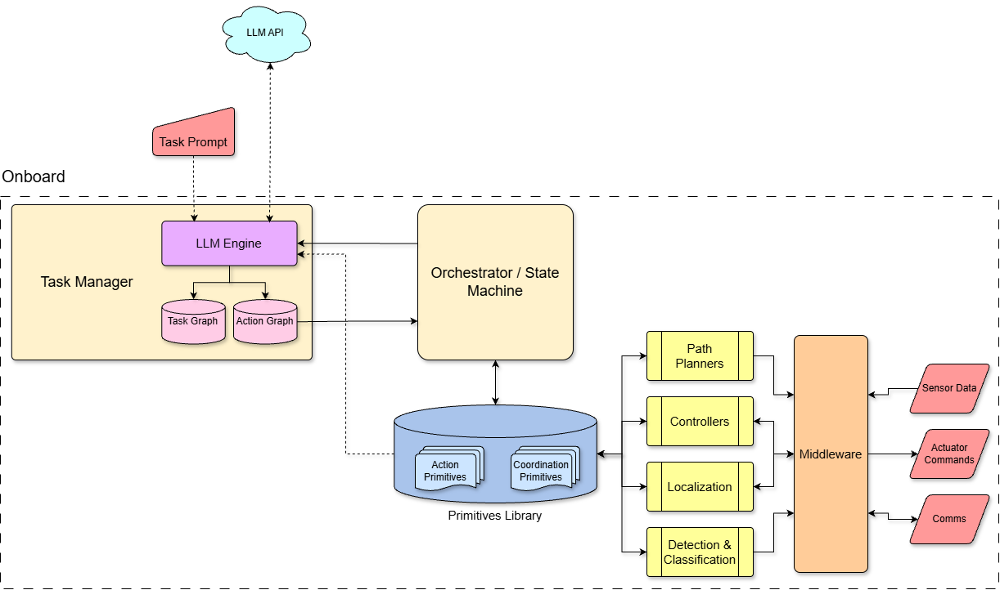

**Author:** Ethan · Oct 15–18

## Overview

With the literature mapped, I drafted the first system and software architecture. The problem has two halves:

- **Cooperation:** robots need a shared plan (explicit or implicit), assigned roles and grasp points, compliance with their teammates, and the ability to adjust to disturbances as a group.
- **Generalization:** the same system should handle more than co-carry, which means understanding a task described in words, breaking it into subtasks, and running those subtasks with replanning when things change.

#### Co-carry system architecture (Oct 15)
The first block diagram turns the literature review into a pipeline for the co-carry task. It splits the work between a centralized part, which can run on the leader robot, and a per-robot part that runs on every robot.

- **Centralized (leader):** a grasp planner takes the object's point cloud and the number of robots, then proposes *k* grasp point + base position pairs. A trajectory check against the offline global path planner rejects pairs that can't finish the route. The grasp point assigner then gives each robot its nearest grasp point.
- **Per robot:** a learned grasping model (a VLA trained on several different objects) produces joint-space targets to reach and grasp. Each robot sends a grasp sync signal to a lift signal accumulator, which releases one lift sync signal when everyone is ready.
- **Transport:** an NMPC planner on each robot follows the global path using its joint limits, obstacle poses, end-effector pose, and global pose from the localization algorithm. A controller switch hands control from the grasping model to the NMPC once the lift sync signal arrives, and passes commands to low-level control.

#### Task-graph software architecture (Oct 17–18)
The proposal is **graph-based task orchestration with deterministic action primitives**:

1. An **LLM task manager** turns a task request into two graphs, both stored as JSON:
   - a **task graph** of the task's objectives
   - an **action graph** of the action and coordination primitives that achieve them
2. An **orchestrator** runs the action graph as a state machine, handling state transitions and replanning.
3. A **primitives library** of modular functions does the actual work.

Example primitives for co-carry:
- Grasp point sampling with a vision-language model
- Grasp point assignment by embedding each candidate and scoring pairs with a dot product (after Alvear et al. 2025)
- Cooperative transport with distributed ADMM under the arms' kinematic constraints

Everything runs onboard except the LLM API. The primitives library connects through middleware to the path planners, controllers, localization, and detection & classification modules, which handle sensor data, actuator commands, and comms.

## What we did

- Defined the software problem space as cooperation + generalization
- Drew the co-carry system architecture, splitting leader-side grasp planning from per-robot grasping, lift sync, and NMPC transport
- Proposed a task-graph architecture with an LLM task manager, an orchestrator, and a primitives library
- Set up the Software folder in the team Drive; Tong and Karthigan wrote alternative architecture proposals the same weekend

## Next steps

- Compare the three architecture proposals as a team and pick one direction
- Define the first set of co-carry primitives and their interfaces
