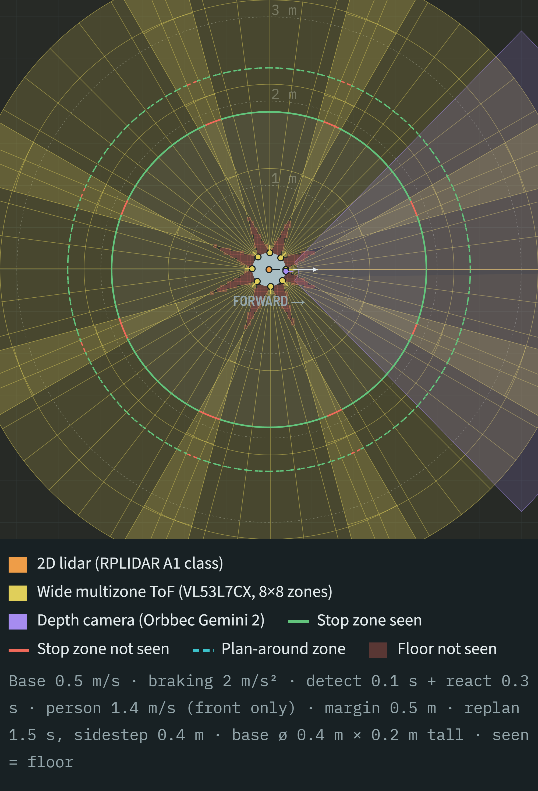
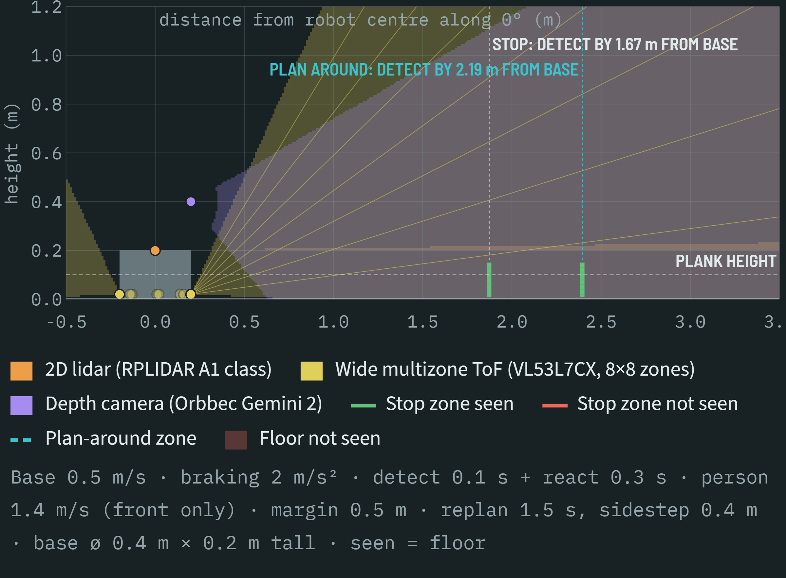
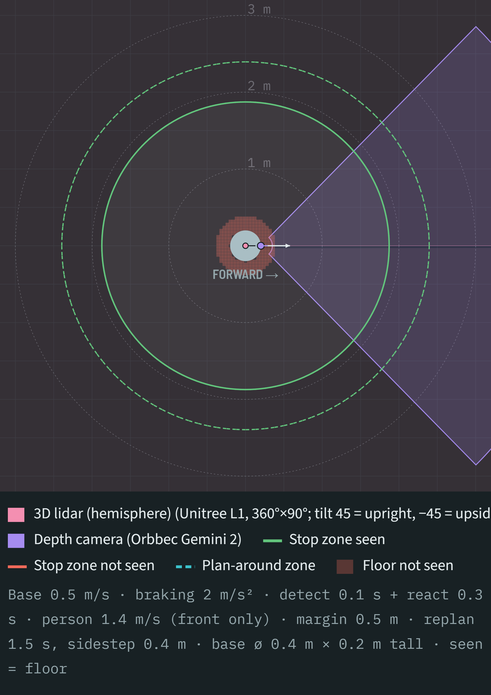
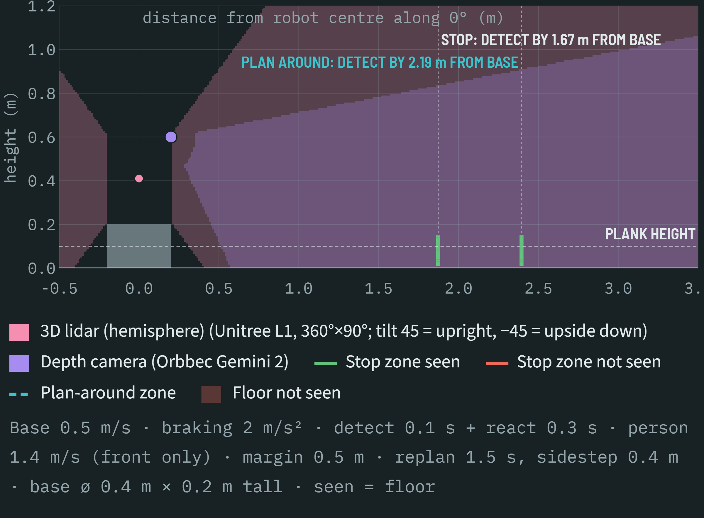

**Author:** Ethan · Oct 18–19

## Overview

With distributed ADMM chosen for cooperative transport, the next question was what each robot needs to sense so the team can see obstacles in time to plan around them or stop. I compared 2D lidar, multizone ToF (VL53L8CX and the wider VL53L7CX), packaged depth cameras, DIY and prebuilt USB stereo, ultrasonics, and 3D lidar (Unitree L1, Livox Mid-360), then scored the realistic loadouts.

#### Coverage tool
I built a small browser tool to place sensors on one robot (0.4 m round base, 0.2 m tall) and see their coverage:

- **Top view:** horizontal field of view, ToF zone grids, and floor blind spots.
- **Side view:** a true vertical section through the robot, with the base blocking each sensor's view.
- **Detection bars:** green or red at each height from floor to plank, at the required detection distance.
- **Figure export:** PNG export for the slides.

The two loadouts below were compared with the same parameters (0.5 m/s, 2 m/s² braking, 0.1 s detect + 0.3 s react, 0.5 m margin). Both carry a forward Orbbec Gemini 2 depth camera for the object and grasping, so the difference between them is the obstacle sensing.

**2D lidar + ToF ring:** an RPLIDAR A1-class lidar on top of the base plus eight VL53L7CX ToF sensors around its edge. The stop ring is mostly green, with short red gaps where neighbouring ToF wedges don't overlap yet. Floor blind spots are the small red star between the ToF sensors right next to the base.

**3D lidar:** a Unitree L1 mounted upside down at 0.4 m on the robot centre. It sees every height out past the stop and plan-around distances in all directions, but the base shadows a ring of floor reaching about 0.2 m past the base edge.

#### How far each robot needs to see
The required detection range in a direction at angle φ from the direction of motion is:

> R(φ) = cos φ · (v·T + v²/2a) + vperson · (T + v/a) + margin

where T is detection plus reaction time. Only head-on approaches depend on our own speed. Sides and rear depend entirely on whether something is moving toward us.

At 0.5 m/s, 2 m/s² braking and 0.4 s total latency, the robot stops in about 0.26 m, but a person walking at 1.4 m/s closes about 0.9 m in the 0.65 s that takes. So the requirement is set by people, not by our speed. With a 0.5 m safety margin:

| Case | Detect by (from base edge) |
| :--- | :--- |
| Static obstacle, stop | ~0.76 m |
| Person walking toward the robot, stop | ~1.67 m |
| Static obstacle, team reroutes the object path (1.5 s replan, 0.4 m sidestep) | ~2.19 m |

Because the bases are omnidirectional, the envelope is a circle, not a forward cone. The tradeoff is cost: full coverage at every height in every direction is expensive, so we can cap speed in directions with shorter sensing range instead. Braking matters mostly because it shortens how long a person has to close the gap: at 0.5 m/s² instead of 2 m/s², the person case grows from 1.67 m to about 2.9 m. Emergency braking deceleration is worth measuring early.

#### Findings that shaped the decision
- **A single scan plane is blind above and below it.** A 2D lidar misses a person lying down, low boxes, and tabletops at plank height. Each loadout needs some vertical coverage.
- **A 3D lidar mounted on top shadows the floor next to the base.** An upside-down L1 at 0.4 m can't see the floor within about 0.2 m of the base edge (see the 3D lidar figures above). That's acceptable while moving, since obstacles seen earlier stay in the local map, but not when starting from rest. A low near-field layer is still needed.
- **Passive stereo is weak indoors.** Plain walls and floors give it nothing to match, and depth is computed on the Pi. Prebuilt synchronized USB modules (~$15) fix the sync and calibration problems but not this one.
- **ToF zones get coarse with range.** A VL53L7CX zone is ~13 cm wide at 1 m and ~26 cm at 2 m, so thin obstacles blend into the background.

#### Decision matrix
Weights: coverage 35%, robustness to error/environment/occlusion 25%, integration effort 25%, cost 15%. All options pass the must-have of detecting a person at a safe distance. Costs are for obstacle sensors only; the Gemini 2 depth camera is on every option.

| Configuration | Cost / robot | Coverage | Robustness | Integration | Cost | Score |
| :--- | :--- | :---: | :---: | :---: | :---: | :---: |
| 3D lidar (Unitree L1) | ~$700 | 4 | 3 | 3 | 1 | 3.05 |
| **2D lidar + 8× ToF** | **~$300** | **3** | **4** | **4** | **3** | **3.50** |
| 3D lidar + 8× ToF | ~$900 | 5 | 4 | 3 | 1 | 3.65 |
| 2D lidar + 8× ToF + USB stereo | ~$315 | 4 | 3.5 | 3 | 2 | 3.33 |

The L1 was priced at $249 when we first looked. It's now out of stock and ~$700 at RobotShop, which dropped it to last place on its own and adds a supply risk. The 3D lidar + ToF combination scores slightly higher than 2D lidar + ToF (3.65 vs 3.50), but at three times the cost per robot and with the same supply risk.

## What we did

- Built a coverage tool for testing sensor loadouts on one robot, with base self-occlusion and PNG export
- Derived stop and plan-around detection envelopes from speed, braking, latency, and person speed
- Worked out that omnidirectional bases need circular coverage, with direction-dependent speed caps as the cheaper alternative
- Checked sensor specs: VL53L7CX is 60°×60° (90° diagonal), the L1 is 360°×90° with a 0.05 m blind spot, and the Mid-360 only sees 7° below horizontal
- Scored four loadouts in a weighted decision matrix

## Decision

**2D lidar + 8 VL53L7CX multizone ToF sensors per robot (~$300).** The lidar handles 360° obstacle and person tracking. The ToF ring covers above and below the lidar plane near the robot, runs on its own microcontroller as an independent stop layer, and confirms the space around the base is clear before moving. A ~$15 forward USB stereo module is the add-on if testing shows mid-range obstacles off the lidar plane are a problem. The 3D lidar, alone or with the ToF ring, was considered and rejected on cost and availability: the combination's 0.15-point edge doesn't justify ~$600 more per robot and a sensor we may not be able to replace.

## Next steps

- Measure emergency braking deceleration with the arm raised and the plank held (worst case for tipping)
- Benchmark 2D lidar leg detection latency and how close a crossing person gets before the team stops
- Bench-test ToF crosstalk between two robots at 940 nm
- Add a bumper or soft skirt for contact, since no sensor can stop the robot in time for fast entries at close range
