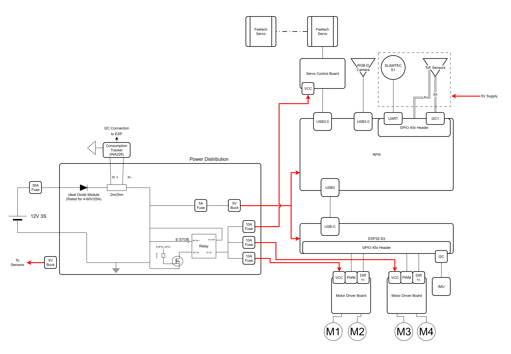

## Overview

After the PDP, the team moved from design decisions toward a robot we can actually build, with each member pushing their own area forward over the last two weeks.

## What we did

#### Camron

##### BOM, Sponsorship & Electrical System

**Finalized the bill of materials.** Every major component now has a chosen part, a price and its electrical rating, so the BOM doubles as the input to the power budget. One robot comes to **$1,458.79 CAD**, or $1,232.89 if the arm servos are sponsored.

| Part | Model | Qty | Total (CAD) | Electrical |
| :--- | :--- | :---: | :---: | :--- |
| Onboard compute | Raspberry Pi 5 + AI | 1 | $600.00 | 5 V / 5 A |
| Arm actuators | Feetech STS3215 | 6 | $225.90 | 12 V, 2.7 A stall |
| Arm servo control board | Waveshare | 2 | $34.00 | — |
| Wheel motors | DFRobot FIT0186 | 4 | $104.48 | 12 V, 7 A stall |
| Motor driver | DFRobot motor driver | 4 | $50.84 | — |
| 2D 360° LiDAR | SLAMTEC RPLiDAR | 1 | $98.57 | 5 V / 0.23 A |
| ToF sensors | Pololu VL53L7CX | 8 | $228.00 | 3.3 V, 0.1 A each |
| IMU | BNO055 | 1 | $50.00 | — |
| Power distribution | Buck converter, protection, etc. | 1 | $67.00 | — |
| **Total** | | | **$1,458.79** | |

A few notes behind the choices:
- **Servo control board:** two per robot, so a spare is on hand if one burns out during testing
- **Wheel motors:** 700 CPR encoders give about 2,797 counts per output revolution with full quadrature, or roughly 0.09 mm of travel per count on an 80 mm wheel. Buying through a distributor avoids the ~$130 and duties of ordering direct
- **Motor driver:** each board drives two motors, with the Cytron Shield-MDD10 as the alternative
- **LiDAR:** at 2 m, neighbouring points are about 2 cm apart, which is enough to pick out a teammate's base
- **ToF sensors:** eight multizone sensors cover both horizontal and vertical field of view for close-range object detection around the robot
- **IMU:** the same BNO055 we have used before, so the driver code carries over
- **Wrist camera:** still open, and not yet in the total

**Sponsorship package.** Helped put together the project pitch the team is taking to potential sponsors. It introduces HOM-E, the gap left by fixed-torso two-armed robots, and our problem statement (locate, coordinate, react), and closes with the per-robot cost breakdown above so a sponsor can see exactly what their contribution covers. The arm servos are the first target, which is why the BOM also tracks the total without them.

**Electrical system.** Laid out the hardware architecture for one robot, covering both how power is distributed and how every component talks to the compute.

*Power.* A 12 V 3S battery feeds everything through a 30 A main fuse and an ideal diode module (rated 4–60 V / 25 A), so a battery connected backwards can't damage anything. Just after the diode, a 2 mΩ shunt with an INA226 current monitor tracks the robot's total power draw and reports it to the ESP32 over I2C. From there the supply splits:
- **Logic:** a 5 A fuse into a 5 V buck that powers the Raspberry Pi 5 and the ESP32-S3, with a second 5 V buck supplying the sensors
- **Actuators:** a 30 A relay, switched by an ESP32 GPIO through a MOSFET with a physical E-stop in the coil circuit, feeds three 10 A fused branches: one for the servo control board and one for each motor driver board

Putting the actuators behind the relay means either the E-stop or the ESP32 can cut power to every motor and servo at once, while the compute stays powered.

*Signals.* The two controllers split the work by speed:
- **Raspberry Pi 5 (high level):** the servo control board and RGB-D camera over USB 3.0, the SLAMTEC LiDAR over UART, and the eight ToF sensors on I2C, with their LPn lines on GPIO to give each one its own address
- **ESP32-S3 (low level):** connected to the Pi over USB-C, it drives both motor driver boards with PWM and direction signals and reads the IMU over I2C

## Next steps

- Lock in the RGB-D wrist camera and add it to the BOM
- Follow up with sponsors on the pitch
- Check the power budget against the servo and wheel stall currents, then order parts
