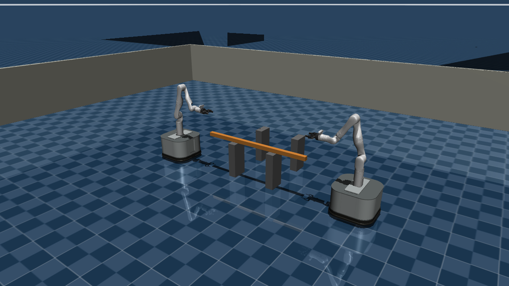
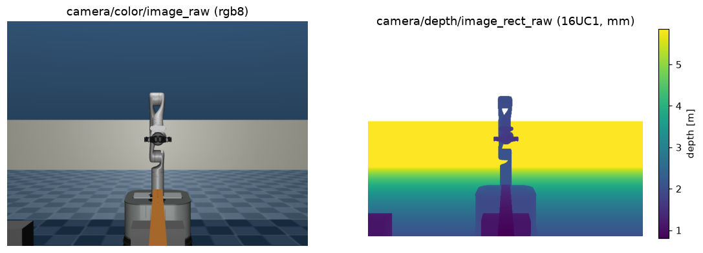
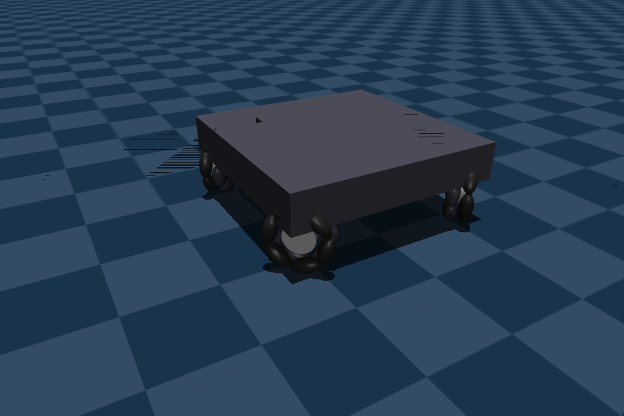

**Author:** Camron · Nov 2 – 9

## Overview

Until this week, the sim's robots knew where they were from a fake odometry model: the true base velocity plus some random noise. This week added the sensors from our [sensor configuration study](/logs/2026-10-19-sensor-configuration-study) to the sim, mounted on the TidyBot placeholder until our own robot model exists.

The rule was that **every sensor is a native MuJoCo sensor**, or MuJoCo's renderer for the camera, with nothing invented on top: no added noise, bias or dropout. The sim gives clean physics values, and the goal is matching *interfaces*, not imperfections.

## Same topics as the real robot

Each simulated sensor publishes through the ROS 2 bridge on the same topic, with the same message type, frame and rate as the real driver or firmware. For the lidar and camera that means copying the public drivers' defaults (`sllidar_ros2`, `realsense2_camera`). For the ToF array and the IMU, which go through our own code on the Pi and ESP32, the sim now **defines the format the real code has to match**.

| Sensor | In MuJoCo | Topic (per robot, `/rN/…`) | Rate |
| --- | --- | --- | --- |
| SLAMTEC S1 lidar | 1080 rangefinders, one per bin | `scan` (`LaserScan`) | 10 Hz |
| RealSense D4xx | Rendered colour + depth | `camera/color/…`, `camera/depth/…` | 15 Hz |
| 8× VL53L7CX ToF | An 8×8 camera rangefinder each | `tof_K/points` (organized `PointCloud2`) | 15 Hz |
| BNO055 IMU | Accelerometer, gyro, orientation, magnetometer | `imu/data`, `imu/mag` | 100 / 20 Hz |

Each sensor samples at its own rate using MuJoCo's built-in sensor intervals, and every message is stamped with the sim time it was measured at. Wrist force/torque and ground-truth poses are published too, but under separate sim-only names. Ground truth lives under `/eval/`, so nothing in the robot stack can accidentally use it.

The lidar sees the robot's own arm tower, as it will on the real deck: the gap on the left wall is the roughly 27° the tower blocks behind the sensor.

## Wheeled omni base

The placeholder base slides on frictionless x, y and yaw joints, so it can't produce wheel encoder readings or slip. I built a standalone replacement that matches the BOM: four 100 mm double omni wheels in an X, each with two rows of passive rollers on their own joints. The wheels are driven by velocity motors capped at the FIT0186's top speed (251 rpm) and stall torque, so the wheels can still slip and saturate.

The rollers are ellipsoids rather than capsules. Capsule ends stick out past the wheel radius, which made the wheel roll on a bumpy, oversized circle.

A test drives the base through a series of moves and compares what it was told to do with what it did:

| Check | Result |
| --- | --- |
| Commanded vs achieved velocity (forward, strafe, diagonal, spin, arc) | Within 1 % |
| Wheel slip | Under 1 % |
| Over-limit command (3 m/s forward) | Capped to 1.86 m/s, achieved 1.85 |
| Wheel-odometry drift after 10.2 m | 42 cm (4.2 %), 2.8° heading |
| Sim speed, one base | About 15× real time |

The drift comes from physics alone, with no noise model, so it's a first look at how much the leaderless controller can rely on wheel odometry between lidar corrections.

## Next steps

- Swap the omni base in for the TidyBot's sliding joints and publish wheel encoders on `wheel/joint_states`.
- Write our robot's URDF and move the sensor mount poses into it, so the sim and hardware share one set of frames.
- Check the placeholder values (mount poses, ToF field of view and range, motor friction) against the real parts and CAD.
