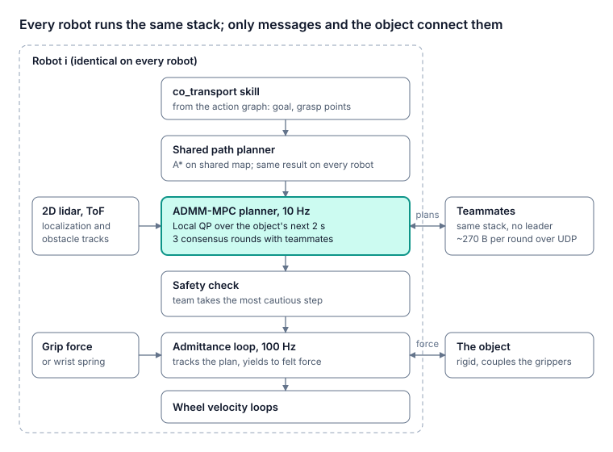

import Cite from '../../components/Cite.astro';

**Author:** Ethan · Nov 9 – 15

## Overview

This week went into the architecture for the next controller: **cooperative transport with no leader**.

The [caster leader–follower controller](/logs/2026-11-02-cocarry-sim-and-caster-controller) works, but one robot is in charge. Only the leader knows where the object is going and only the leader plans around obstacles. If the follower sees a person the leader can't, nothing changes. The goal here is a controller where every robot runs the same code, any robot's view of an obstacle shapes the team's path, and the team can still stop safely if Wi-Fi drops.

## Architecture

The controller has two layers running at two rates.

- **Planning, 10 Hz: distributed MPC.** Each robot solves a small optimization for where the **object** should go over the next 2 s, given its own speed limits and the obstacles it can see. The robots then agree on one plan using consensus ADMM. This slots into the action graph as one skill, `co_transport(goal_pose, grasp_assignment)`.
- **Control, 100 Hz: admittance.** Each base tracks its part of the agreed plan but yields to the force it feels through the object, like a spring. Odometry drift and timing jitter leave centimetre-level errors between robots, and with a rigid object those errors become squeeze. This loop absorbs them. It needs no messages, so it keeps working if the network drops.

ADMM can't replace the admittance loop. Agreement over Wi-Fi takes tens of milliseconds, and grip errors build up in milliseconds.

#### What the robots agree on

The shared variable is the object's trajectory, not the robots' motions. Each robot's own base path follows from where it grips the object, so the problem each robot solves stays the same size (about 130 variables) whatever the team size. This idea comes from Shorinwa and Schwager's collaborative manipulation work.<Cite id="shorinwa-2020" />

#### One planning cycle

1. Robots share their estimates of the object's pose and average them as the starting point.
2. **Local solve.** Each robot solves its own quadratic program: follow the reference path, move smoothly, respect its own base limits, and keep its part of the object clear of the obstacles it sees.
3. **Broadcast and average.** Each robot sends its version of the object trajectory, about 270 bytes, and every robot computes the same average.
4. **Price the disagreement.** Each robot keeps a running "price" for how far its own plan is from the average. A robot that keeps getting pulled away by an obstacle only it can see pulls the average harder each round, so the team bends toward it.
5. Repeat steps 2–4 three times, then run a **safety check**: each robot tests the agreed next step against its own limits and clearance, and the whole team takes the most cautious answer.
6. Each robot turns the agreed step into its own base target and hands it to the admittance loop.

Obstacles enter each robot's optimization as straight-line keep-out constraints, rebuilt every cycle from the closest point on each obstacle. People and boxes are tracked lidar clusters with a velocity. Walls come from the shared map as line segments.

#### When messages stop

Every agreed plan has to end with the object at rest. If a teammate goes silent for 200 ms, every robot follows the last agreed plan to a stop. All robots apply the same rule to the same plan, so they stop together without talking. The admittance loop switches to pure damping so any leftover mismatch is yielded to, not fought.

## Desktop prototype

To check the design before porting it, I wrote a small Python prototype: planar, kinematic, OSQP for the quadratic programs. The test: carry the object 6 m past a pillar while a person walks across the path at 0.8 m/s.

| Measure (3 ADMM rounds per cycle) | 2 robots | 4 robots |
| --- | --- | --- |
| Time to goal, 6 m | 19.9 s | 21.3 s |
| Minimum clearance to any obstacle | 0.13 m | 0.13 m |
| Median disagreement between robots' plans | 0.6 cm | 1.0 cm |
| Solve time, median / 95th percentile (desktop) | 2.5 / 14.8 ms | 1.8 / 7.3 ms |

Every run from 1 to 10 rounds per cycle reached the goal with no collision and no base speed violation. Thirty rounds, which is close to solving it centrally, was only 0.2 s faster than three.

The prototype also exposed three problems, and each one changed the design:

| Without… | What happened | Fix |
| --- | --- | --- |
| A shared path planner | Four robots stuck nose-on at the pillar; no robot "chose" a side | Every robot runs the same deterministic A* on the shared map, so they start from the same route around static obstacles |
| A yield window | The team swerved the same way the person walked, got caught, and was hit while stopped | Each robot keeps clear of where a moving obstacle will be over the next 1.5 s, not just where it is now |
| The safety check | Base commands up to 0.05 m/s over the limit | One extra broadcast; the team takes the smallest safe step |

The prototype doesn't model sensor noise, localization error, Wi-Fi jitter, wheel slip or the admittance loop. It tests the planner's logic, not timing on the Raspberry Pi 5.

## Open problem: sensing force at the grip

The admittance loop needs a signal for how hard the object is pulling on each gripper, and we don't have a reliable one yet. The planned gripper force sensor may only measure grip force, not the sideways pull that matters here. The STS3215 servos report joint load, but the extra gear stages add friction and backlash that can hide small external forces.

The idea we'll test next is to sense displacement instead of force. Let the arm (or a sprung wrist) give slightly like a spring, measure how far it's pushed off its nominal pose with the joint encoders, and have the base move to drive that offset back to zero. Admittance only needs a signal that grows with the pull, not a calibrated force in newtons.

## Next steps

- Port the planner into the MuJoCo sim behind the same `Robot` interface as the caster controller, so the two can be compared directly.
- Measure Pi 5 solve time and Wi-Fi round time. One cycle needs five message rounds and three solves in 100 ms.
- Bench-test one arm: hang known weights and compare the servos' load readings against how far the arm deflects, to choose the force signal for the admittance loop.
- Decide whether to extend the object path to 3D (height plus a small tilt) for lifting over low obstacles.
