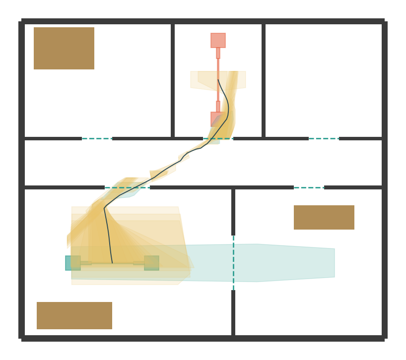
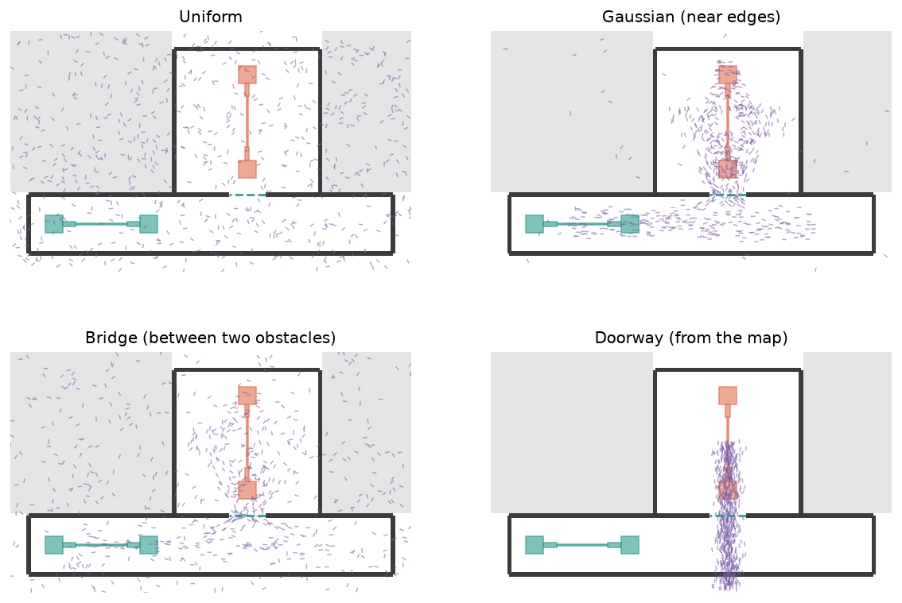
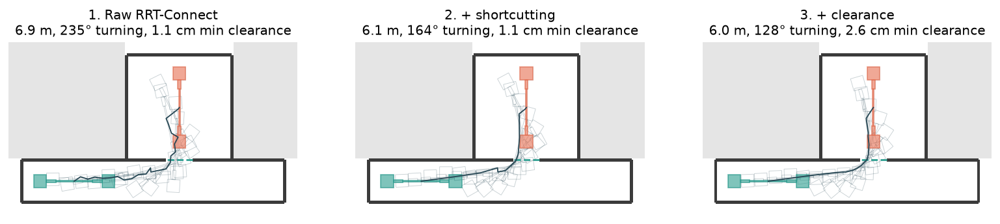
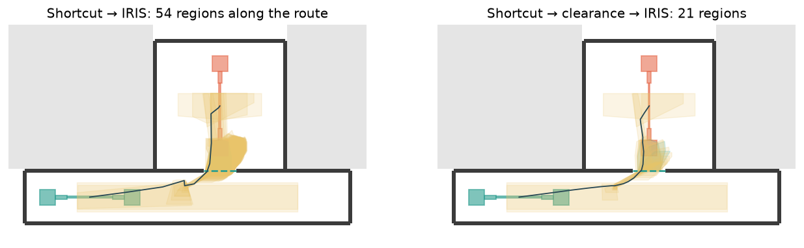
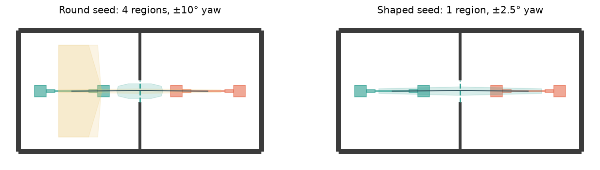

import Cite from '../../components/Cite.astro';

**Author:** Camron · Nov 10 – 16

## Overview

The [leaderless transport controller](/logs/2026-11-15-leaderless-cooperative-transport) plans the next 2 s locally, but it needs a route through the house to follow. This week went into that **global planner**: given a known floorplan, a start and a goal, find a pose path (x, y, yaw) for the carried object, then turn it into an **IRIS corridor**, a chain of convex obstacle-free regions that the MPC can treat as linear constraints.

The planner collides the **whole formation**, not just the payload: the 1.4 m bar, both TidyBot bases and the arms between them, 3.08 × 0.48 m in total. That's long for a house. Most of the difficulty this week was getting a 3 m rectangle through a 1 m door off a 1.5 m hallway.



## Pipeline

Each stage is a plugin, and stages chain from the command line, so any one piece can be swapped:

```
rrt_connect(sampler='uniform:0.7,doorway:0.3') + shortcut + clearance + iris
```

1. **RRT-Connect**<Cite id="rrt-connect" /> grows a tree from the start and one from the goal until they join.
2. **Shortcutting** removes needless turns, first in yaw and then in x, y.
3. **Clearance** pushes the path away from walls with an elastic band.
4. **IRIS**<Cite id="iris" /> grows convex regions along the path for the MPC.

A 2D early-exit check runs first and rules out routes that are provably impossible, such as a door narrower than a base, in a few milliseconds.

### Trusting the results

A random planner that times out tells you nothing on its own: maybe the route is impossible, or maybe the planner is weak. So every scenario carries a **proven label**. Feasible routes have a witness path, either hand-built or found by an exhaustive (x, y, yaw) grid search and then re-checked exactly. Infeasible ones have a written bound (door width, or the classic ladder-around-a-corner bound). The benchmark re-checks every returned path with its own validator and grades it against the label, so a planner bug can't pass as a success.

The benchmark set has nine feasible routes: an open room, a doorway, a side door off a hallway, two L-shaped corners (1.60 m and a tight 1.45 m, about 6 cm to spare), and four routes through an accessible house.

## Sampling distributions

Where RRT draws its random poses decides whether it ever finds the doorway. I compared four samplers and several mixtures of them on the hardest single test, turning 90° through the side door:



- **Uniform** covers everything, including outside the building, and rarely lands in the door.
- **Gaussian**<Cite id="gaussian-sampling" /> keeps samples next to an obstacle edge.
- **Bridge**<Cite id="bridge-test" /> keeps samples squeezed between two obstacles.
- **Doorway** uses the map's door annotations directly: it places the formation on the line through a door, pointed through it.

| Sampler (20 seeds, 10 s limit) | Solved |
| --- | --- |
| **70 % uniform, 30 % doorway** | **75 %** |
| 50 % uniform, 50 % Gaussian | 50 % |
| Gaussian | 45 % |
| Uniform | 40 % |
| 70 % uniform, 30 % Gaussian | 40 % |
| 60 % uniform, 20 % doorway, 20 % bridge | 25 % |
| Bridge | 20 % |
| Doorway | 10 % |

The 70/30 uniform–doorway mix won in all three repeats and is now the default. The focused samplers on their own did worst: doorway sampling alone puts almost nothing in the rooms, so the trees never reach the door from either end. The bias only helps when uniform sampling is still exploring.

## Smoothing and clearance

Raw RRT paths zig-zag, in yaw as well as position. That matters later: every wiggle in heading costs IRIS another region. The same side-door path through each post-processing step:



**Shortcutting** tries to replace a stretch of path with a straight one. A plain shortcut would also straighten the heading, which in a doorway is often what keeps the bar from hitting the frame, so it runs as a *partial* shortcut: first only yaw, then only x, y. Over 6 seeds, total turning dropped from 230° to 106° (the minimum for this route is 90°) and length from 7.07 to 6.09 m. I tried seven shortcut variants. The differences were small, and on the house routes most of the turning is required anyway (kitchen to bedroom 2 is about four 90° turns).

**Clearance** turned out to matter more. Shortcutting pulls the path tight against corners, and IRIS can only grow small regions there. An elastic band that pushes waypoints toward 15 cm of clearance cut the corridor in half or better:



| Route (4 seeds) | Regions without clearance | With clearance |
| --- | --- | --- |
| Side door | 44 | **18** |
| House: living room → bath | 46 | **31** |
| L-corner, 1.60 m | 29 | **12** |

## IRIS corridors

IRIS works in (x, y), with each region valid for an interval of yaw. For each obstacle and each part of the formation, it computes where the formation's centre can't go at any yaw in that interval, then grows the largest convex region that avoids all of them. The MPC gets the regions in order and only needs to hand over from one to the next where two overlap.

**Seeding.** Seeds go at doors first: a fan of headings at each door's narrowest point, since that's where regions are hardest to grow. Then seeds go only where the path isn't covered yet, and repair seeds go wherever two consecutive regions don't share a pose. Door-first seeding saved 2–5 regions on door routes.

**Seed shape.** IRIS normally starts from a tiny round ellipse. In a doorway that grows a region that's wide sideways but short along the way through, so it takes several to cross. I changed the seed to an ellipse stretched along the bar by how much free room there is in each direction. Where the room along the bar is at least 3× the room sideways, the region's yaw range is also capped at ±2.5°, so the sideways slack goes to x, y instead of rotation:



The doorway went from 4 regions to 1, and the open-plan opening in the house from 3 to 1 with 50 % more area. Capping yaw in *turning* passages backfired, though: a ±2.5° region covers only 5° of a 90° turn, so turning routes needed 5–11 more regions. The cap now applies only where the route keeps its heading.

## Full pipeline and other objects

The full pipeline solved every feasible route on every seed with no invalid paths, no gaps between regions and no uncovered poses. It timed out, correctly, on the two proven-impossible ones.

| Route | Time | Turning | Min clearance | Regions |
| --- | --- | --- | --- | --- |
| Open room | 6 s | 90° | 56 cm | 8 |
| Doorway | 5 s | 0° | 21 cm | 1 |
| Side door | 9 s | 91° | 2.9 cm | 16 |
| L-corner, 1.60 m | 11 s | 90° | 12 cm | 12 |
| L-corner, 1.45 m | 12 s | 90° | 9 cm | 16 |
| House: living room → kitchen | 15 s | 0° | 66 cm | 1 |
| House: living room → bedroom 1 | 38 s | 213° | 2.9 cm | 22 |
| House: kitchen → bedroom 2 | 117 s | 339° | 3.4 cm | 45 |
| House: living room → bath | 29 s | 207° | 5.5 cm | 30 |

Times are from a desktop with several jobs sharing the CPU. This planner runs once per task, not in the control loop, but the long house routes will still need to come down.

I also ran seven carried objects through the same floorplans, from a short bar to a 2.0 × 0.9 m sofa. The main lesson: **width matters as much as length**. A table's formation is shorter than the bar's (2.88 vs 3.08 m) but 0.8 m wide, and it can't make the side door, the tight corner or two of the house routes that the bar can.

## Next steps

- Scale from 2D floorplans to a full 3D simulation. Everything so far plans on flat 2D maps with 2D footprints. Next is building the same floorplans as 3D MuJoCo scenes and checking paths against real 3D geometry: wall and door heights, furniture the object can pass over, and the arms and object at their actual heights.
- Hand the corridor to the MPC and track it in that 3D sim on the same floorplans.
- Regions in full (x, y, yaw), so a turn can be covered by a few regions instead of many thin yaw slices.
- Decide whether base spacing should be a planner variable. It decides which rooms a given object can reach.
- Make start and goal poses adapt to the object, so large objects can be tested on every floorplan.
- Add roll and pitch, so the object can tilt or lift over low furniture. Walls and doors already store heights.
